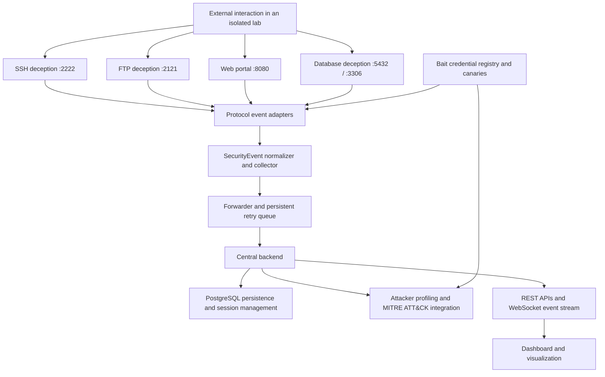

DRISHTI — Adaptive Distributed Cyber Deception Platform
DRISHTI is a distributed cyber-deception platform that deploys realistic decoy services, captures interactions with those services, correlates activity across deception assets, and forwards normalized security events to a central backend for persistence, threat analysis, and visualization.
Project status: The project handoff reports all seven implementation phases complete and 89/89 automated tests passing (61 deception-infrastructure tests and 28 backend tests). Automated test success should be complemented by the manual integration and deployment checks described below before using the platform outside an isolated lab.

Contents
- Overview
- Key capabilities
- Architecture
- Deception services
- Event pipeline
- Technology stack
- Repository structure
- Getting started
- Running the platform
- Testing and attack simulation
- Integration contract
- Security and operational notes
- Project status
Overview
Traditional security monitoring often depends on recognizing malicious activity against real infrastructure. DRISHTI takes a deception-first approach: it presents controlled, fictional services and data that are designed to attract and record suspicious interactions.

The platform brings together four deception surfaces:
1. SSH honeypot — a simulated Linux host with a HoneyFS overlay and virtual shell.
2. FTP honeypot — an asynchronous FTP service backed by an isolated virtual filesystem.
3. Web portal honeypot — a fictional corporate administration portal with monitored application flows.
4. Database honeypots — PostgreSQL- and MySQL-compatible decoy services with in-memory data.
Events from these assets are normalized into a shared SecurityEvent schema, collected by a forwarding daemon, and delivered to the central backend. Bait credentials and canaries help identify when decoy information is accessed or reused across services.
Key capabilities
- Multi-protocol deception: SSH, FTP, HTTP, PostgreSQL, and MySQL decoy services.
- HoneyFS and virtual filesystem isolation: believable files and directory structures without exposing the host filesystem.
- Fictional corporate data: decoy employee, customer, finance, payroll, and transaction records.
- Bait credentials and canaries: detection of decoy credential use, with credential rotation support.
- Cross-service correlation: detection of bait credentials reused across different deception assets, producing high-priority credential-reuse alerts.
- Reconnaissance and interaction telemetry: visibility into failed logins, command execution, directory listing, downloads, suspicious HTTP probes, and database enumeration.
- Sensitive-data redaction: web authentication telemetry records password length rather than storing the submitted password.
- Reliable event forwarding: buffered events, a persistent SQLite retry queue, exponential backoff, deduplication, and dead-letter state transitions.
- Centralized monitoring: backend session management, attacker profiling, REST APIs, WebSocket streaming, and MITRE ATT&CK integration.
- Attack simulation: individual service simulations and a multi-stage cross-service kill-chain script.
- Containerized deployment: Dockerfile and Docker Compose configuration for multi-container operation.
Architecture

Event lifecycle
1. An interaction occurs on one of the decoy services.
2. The service-specific adapter converts the interaction into the shared SecurityEvent format.
3. The collector buffers and normalizes events.
4. The forwarder sends event batches to the central backend through POST /api/events.
5. If delivery fails, events are retained in the SQLite retry queue and retried using exponential backoff.
6. The backend persists events and makes them available to the threat-intelligence and dashboard components.
7. Canary activation or cross-service credential reuse can generate high-priority alerts.
Deception services
Asset	Port(s)	Description	Example monitored activity
ssh-001	2222	Cowrie-based Linux server simulation named finance-server, with HoneyFS overlays and virtual shell behavior.	Failed and successful logins, commands, file uploads, and bait credential use.
ftp-001	2121	Asynchronous RFC 959 FTP honeypot with a jailed virtual filesystem.	Authentication attempts, directory listing, file downloads, suspicious paths, and bait credential use.
web-001	8080	Fictional Apex Financial Group administration portal with six application views.	Login attempts, brute-force behavior, reconnaissance probes, decoy report downloads, and bait configuration access.
db-001	5432, 3306	PostgreSQL v3.0 and MySQL protocol-compatible decoy database services backed by in-memory schemas.	Authentication attempts, database and table enumeration, and SQL queries.

Web portal views
The fictional corporate portal includes:
- Admin Login
- Operations Dashboard
- Employee Directory
- Financial Ledgers
- Database Management
- System Configuration
The portal monitors repeated login failures (with a brute-force threshold of three or more attempts), suspicious scanner paths such as /.env and /wp-admin, and interactions with decoy reports and configuration data.
Database decoy data
The in-memory database services expose fictional schemas such as:
- corporate_finance
- employee_records
- customer_accounts
- payroll_2026
- transaction_history
The decoy database layer is designed to return believable responses while remaining isolated from host storage. It supports common enumeration commands such as SHOW DATABASES and SHOW TABLES, along with supported SQL query flows.
Event pipeline
The collector and forwarding components are responsible for turning service-specific telemetry into a consistent stream for the backend.
Component	Responsibility
normalizer.py	Dispatches protocol-specific telemetry into the unified event format.
event_collector.py	Provides thread-safe in-memory and file buffering.
retry_queue.py	Stores pending events in SQLite and manages retry, deduplication, and dead-letter states.
forwarder.py	Sends HTTP event batches to the central backend and falls back to the retry queue when delivery fails.
daemon.py	Provides lifecycle commands and health reporting for the collector.

The collector health report includes uptime, delivery counts, queue depth, and dead-letter statistics. The retry mechanism is designed for at-least-once delivery; downstream consumers should therefore tolerate duplicate delivery where applicable.
Technology stack
Area	Technologies / components
Core implementation	Python, asynchronous service components
SSH deception	Cowrie, HoneyFS, SSH event adapter
FTP deception	RFC 959-compatible asynchronous server, isolated virtual filesystem
Web deception	FastAPI, Uvicorn, Jinja2
Database deception	PostgreSQL and MySQL protocol engines, in-memory decoy schemas
Central backend	FastAPI application, PostgreSQL, SQLAlchemy, REST APIs, WebSockets
Event delivery	HTTP batch forwarding, SQLite retry queue
Threat intelligence	MITRE ATT&CK mapping and attacker profiling
Testing	pytest
Deployment	Docker, Docker Compose

Repository structure
.
├── services/
│   ├── ssh/                 # SSH honeypot, HoneyFS, adapter, runner
│   ├── ftp/                 # FTP honeypot, virtual filesystem, adapter, runner
│   ├── web/                 # Web portal, routes, templates, adapter, runner
│   ├── database/            # PostgreSQL/MySQL decoys, schemas, adapter, runner
│   └── credentials/         # Bait credential registry and canary logic
├── credentials/             # Local decoy credential data
├── collector/                # Normalizer, collector, retry queue, forwarder, daemon
├── shared/                   # Shared event schema, configuration, logging
├── backend/                  # Central API, persistence, sessions, profiling, integrations
├── tests/                    # Deception, collector, adapter, and integration tests
├── backend/tests/            # Central backend tests
├── scripts/                  # Individual and full attack simulation scripts
├── Dockerfile
├── docker-compose.yml
├── requirements.txt
├── .env.example
└── README.md
Getting started
Prerequisites
- Python 3.12 (the recorded test run used Python 3.12.13)
- pip
- Git
- Docker and Docker Compose, if using the containerized deployment
- A PostgreSQL instance for the central backend, configured according to the project's environment template
Confirm that the required ports are available before starting the services. The decoy PostgreSQL listener uses port 5432; make sure it does not conflict with the PostgreSQL instance used for backend persistence. In a container deployment, confirm that the Compose network and service configuration keep these roles correctly separated.
1. Clone the repository
git clone <repository-url>
cd <repository-directory>
Replace the placeholders with the repository URL and directory name used by your team.
2. Create and activate a virtual environment
Windows PowerShell:
py -3.12 -m venv .venv
.\.venv\Scripts\Activate.ps1
Linux / macOS:
python3.12 -m venv .venv
source .venv/bin/activate
3. Install dependencies
python -m pip install --upgrade pip
pip install -r requirements.txt
4. Configure environment variables
Windows PowerShell:
Copy-Item .env.example .env
Linux / macOS:
cp .env.example .env
Update .env using the variable names and descriptions in .env.example. Configure the central backend's PostgreSQL connection and the event-forwarding destination before running the integrated platform. Do not commit the populated .env file.
Running the platform
Run each service in a separate terminal from the repository root. Activate the virtual environment in each terminal first.
Start the central backend
python -m uvicorn backend.app.main:app --host 127.0.0.1 --port 8000
The backend command shown here binds to localhost for safer local testing. For container-to-container or controlled network access, configure the bind address and firewall rules deliberately rather than exposing the service unintentionally.
Start the collector daemon
python collector/daemon.py start
python collector/daemon.py health
The daemon also provides stop, restart, status, and flush commands.
Start the deception services
Run each command in its own terminal:

SSH honeypot — port 2222
python services/ssh/runner.py run --port 2222
FTP honeypot — port 2121
python services/ftp/runner.py run --port 2121
Web portal — port 8080
python services/web/runner.py run --port 8080
PostgreSQL and MySQL decoys — ports 5432 and 3306
python services/database/runner.py run --pg-port 5432 --mysql-port 3306
Service port reference
Component	Default port
SSH deception	2222
FTP deception	2121
Web portal	8080
PostgreSQL deception	5432
MySQL deception	3306
Central backend	8000

Testing and attack simulation
Run the deception-infrastructure test suite
python -m pytest tests/ -v
The recorded Windows test run completed with 61 passed in 13.51 seconds.
Run the complete test suite, including backend tests
python -m pytest tests/ backend/tests/ -v
The project handoff reports 89/89 passing tests across the 61 platform tests and 28 backend tests. Re-run the command above in your current environment to verify the result against the latest code and configuration.
Run individual simulations
python scripts/simulate_ssh_attack.py
python scripts/simulate_ftp_attack.py
python scripts/simulate_web_attack.py
Run the full multi-stage simulation
python scripts/simulate_full_killchain.py
The full simulation is designed to demonstrate progression across SSH, FTP, the web portal, database interaction, canary correlation, and event forwarding. Run simulations only against your own isolated DRISHTI environment.
Containerized deployment
Build and start the configured services:
docker-compose up -d --build
View aggregated logs:
docker-compose logs -f
Check container status:
docker-compose ps
Stop the services:
docker-compose down
Review and configure the Compose file and environment variables before deployment. Confirm service health, port mappings, network isolation, and persistent storage behavior in your environment.
Integration contract
DRISHTI is divided into four cooperating work areas:
Work area	Responsibility	Integration contract
Deception infrastructure	Decoy services, HoneyFS, bait credentials, canaries, and event forwarding	Emits validated SecurityEvent JSON objects through the collector/HTTP forwarding path.
Central backend	Event ingestion, relational persistence, sessions, attacker profiles, REST APIs, and WebSockets	Consumes normalized event batches through POST /api/events.
Threat detection and intelligence	Event evaluation, MITRE ATT&CK mapping, and risk scoring	Evaluates the normalized security-event stream and produces threat context.
Dashboard and visualization	Security monitoring interface	Displays decoy activity, attack timelines, attacker context, and canary alerts.

The shared SecurityEvent schema is the boundary between the deception assets and the central event-processing pipeline. Changes to that schema should be coordinated across service adapters, the collector, backend ingestion, and downstream consumers.
Security and operational notes
DRISHTI is a security research and demonstration platform. Its decoy services are intentionally interactive and must be operated with appropriate isolation.
- Use an isolated lab network. Do not expose honeypot services or the backend directly to the public internet without a dedicated security review and network controls.
- Use fictional data only. Do not place real customer records, employee information, production files, or actual credentials in decoy assets.
- Never reuse real passwords. Bait credentials must be unique, fictitious, and limited to the deception environment.
- Protect configuration and runtime data. Keep .env, local credential files, database files, logs, and other sensitive runtime artifacts out of version control.
- Keep decoys isolated from host storage. Preserve the virtual filesystem and in-memory database boundaries; do not mount sensitive host directories into deception containers.
- Restrict network access. Apply firewall rules and container network controls, and expose only the ports required for a controlled test.
- Validate recovery behavior. Test collector restart, retry-queue recovery, forwarding failures, and backend availability before relying on event delivery.
- Review logs and retention. Ensure collected telemetry is stored, accessed, and retained in accordance with your lab's data-handling requirements.
Project status
The project notes describe seven implementation phases:
Phase	Deliverable	Reported status
1	SSH deception	Implemented
2	FTP deception	Implemented
3	Web admin portal deception	Implemented
4	PostgreSQL and MySQL deception	Implemented
5	Dynamic bait credential registry and canaries	Implemented
6	Central event collection and forwarding daemon	Implemented
7	End-to-end integration tests and container deployment configuration	Implemented

Automated verification: 61 platform tests and 28 backend tests are reported as passing (89 total). The detailed test output in the project handoff shows the 61-test platform suite.

Recommended final validation: Automated tests do not replace manual acceptance testing. Before a final demonstration or wider deployment, verify service access with real SSH, FTP, browser, and database clients; test collector recovery and retry behavior; inspect REST and WebSocket event delivery; confirm Docker deployment health; and run the complete multi-stage simulation.
Team contributions
- Deception infrastructure: service emulation, HoneyFS/VFS isolation, bait credential registry, canary detection, event adapters, and forwarding daemon.
- Central backend: event ingestion, PostgreSQL/SQLAlchemy persistence, session management, attacker profiling, REST APIs, WebSockets, and MITRE ATT&CK integration.
- Threat intelligence: event evaluation, MITRE ATT&CK mapping, and risk scoring.
- Dashboard: visualization of decoy activity, attacker timelines, and alerts.

  <strong>DRISHTI</strong> 
  Deceive. Observe. Correlate. Understand.

